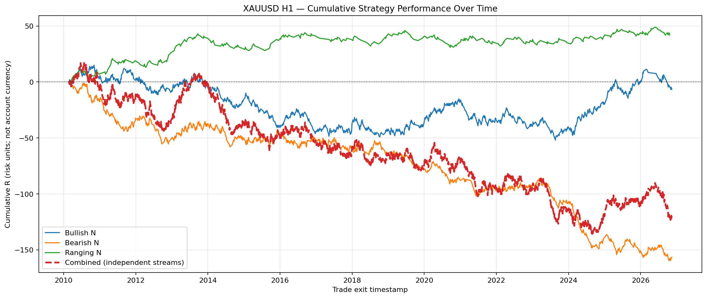
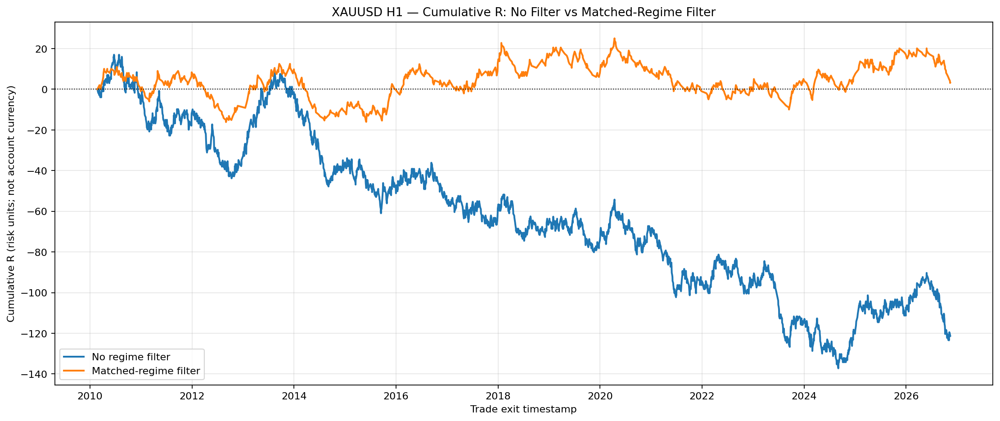
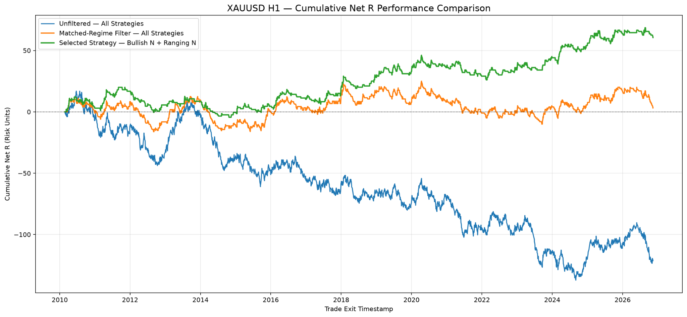

# 03 — Baseline EMA/ADX regime classifier

## Why this baseline?

The baseline is deliberately simple, deterministic, and interpretable. EMA alignment supplies directional bias; ADX estimates trend strength. ADX alone does not determine direction.

## Rules

| Regime | Condition |
|---|---|
| Bullish | ADX(14) ≥ 20 and EMA(50) > EMA(200) |
| Bearish | ADX(14) ≥ 20 and EMA(50) < EMA(200) |
| Sideways | ADX(14) < 20 |
| Unclassified | Required indicator values unavailable; or equal EMAs while ADX ≥ 20 in the later swing experiment |

Indicators are calculated on H1 candles. A regime used to filter a setup is read at its **setup-confirmation candle**. The pending order becomes active on the following candle.

## Selected strategy mapping

The working trading hypothesis used in Notebooks 04 and 05 is:

- Bullish N → only in Bullish regime.
- Ranging N → only in Sideways regime.
- Bearish N → excluded.

This is a research selection rule, not a guarantee that the regime labels predict future direction.

## Baseline context from Notebook 02

The unfiltered strategies generated 2,946 valid trades:

| Strategy | Trades | Win rate | Net R | Profit factor |
|---|---:|---:|---:|---:|
| Bullish N | 1,302 | 33.56% | -6.69R | 0.992 |
| Bearish N | 1,227 | 29.67% | -156.68R | 0.823 |
| Ranging N | 417 | 36.69% | +41.99R | 1.159 |
| All strategies | 2,946 | 32.38% | -121.39R | 0.940 |

The pre-defined matched-regime subset was:

| Strategy | Regime selection | Trades | Net R | Profit factor |
|---|---|---:|---:|---:|
| Bullish N | Bullish only | 447 | +29.54R | 1.102 |
| Bearish N | Bearish only | 363 | -57.41R | 0.782 |
| Ranging N | Sideways only | 167 | +31.00R | 1.307 |
| All matched | All three mappings | 977 | +3.13R | 1.005 |

The aggregate matched result was only marginally positive before costs. The selected two-strategy hypothesis (Bullish N + Bullish; Ranging N + Sideways) was examined further in later notebooks.

## Limitations

EMA and ADX are lagging indicators. Regime changes may be recognized only after a transition has started. Conditional historical performance does not prove that the filter caused the difference. H1 results are sensitive to spread and slippage, which are not modelled here. Notebook 02 also evaluates strategy streams independently; its combined trade-level curve is not a shared-capital portfolio simulation.
