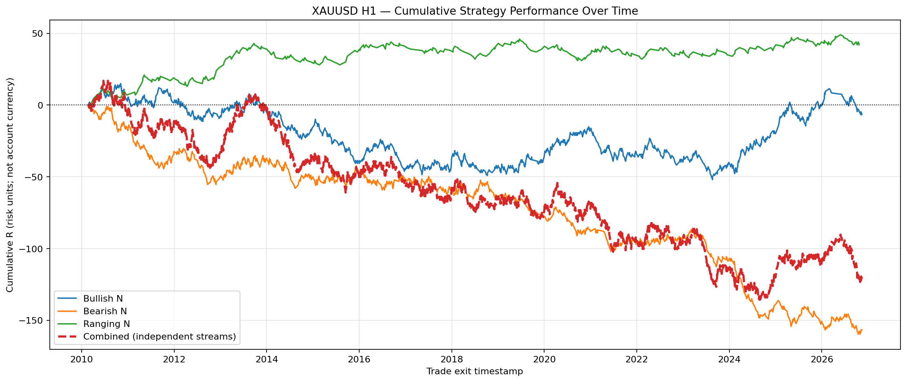

# 04 — Notebook 01: N-Method backtest

**Source notebook:** [`01_N_Method_Backtest_H1.ipynb`](../notebooks/01_N_Method_Backtest_H1.ipynb)

## Purpose

Notebook 01 establishes a starting point by backtesting three rule-based pattern variants on XAUUSD H1 without regime selection:

1. Bullish N.
2. Bearish N.
3. Ranging N.

The take-profit is fixed at 2R. The numerical parameter settings were carried over from the earlier D1 experiment rather than rescaled for H1.

## Historical results

| Strategy | Trades | Win rate | Net R | Profit factor | Average R | Max consecutive losses |
|---|---:|---:|---:|---:|---:|---:|
| Bullish N | 1,302 | 33.56% | -6.69R | 0.992 | -0.005R | 15 |
| Bearish N | 1,227 | 29.67% | -156.68R | 0.823 | -0.128R | 17 |
| Ranging N | 417 | 36.69% | +41.99R | 1.159 | +0.101R | 9 |

## Interpretation

- Bullish N was approximately breakeven before costs in the unfiltered sample.
- Bearish N was the weakest variant and produced a substantial negative Net R.
- Ranging N was positive in this historical sample, but still requires validation after costs and on unseen data.

## Important assumptions

- Each strategy is backtested independently with one position at a time.
- The strategy streams do not share a portfolio-level exposure cap in this notebook.
- Ranging N uses OCO logic; ambiguous same-candle triggers are excluded.
- If SL and TP are touched in the same candle, SL is assumed first.
- Gap-aware fills are modelled from OHLC bars, but spread, commission, swap, and extra slippage are not included.
- `OPEN_AT_END` is a mark-to-market observation at the final close, not a realized closed trade.

The pattern definitions are operational research rules, not a verified reproduction of a proprietary rulebook.
