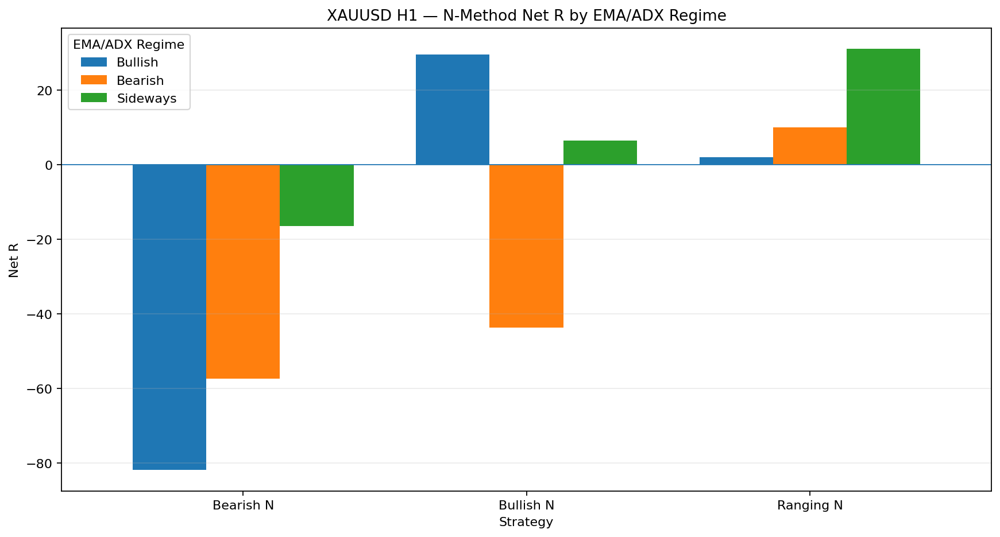
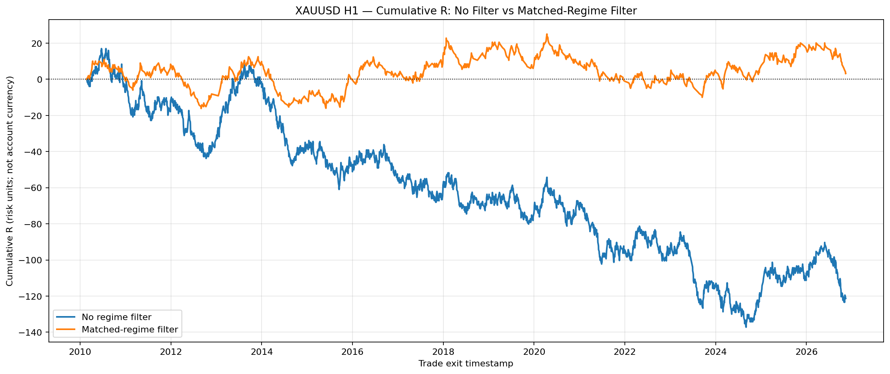

# 05 — Notebook 02: Regime performance analysis

**Source notebook:** [`02_Baseline_Regime_Analysis_H1.ipynb`](../notebooks/02_Baseline_Regime_Analysis_H1.ipynb)

## Purpose

Notebook 02 asks whether the three N-Method variants behave differently in Bullish, Bearish, and Sideways market conditions. Each trade is assigned the regime at its `signal_date`, when the setup is confirmed. The pending entry becomes active on the following H1 bar.

## Regime distribution

| Regime | H1 bars | Share |
|---|---:|---:|
| Bullish | 37,711 | 37.711% |
| Bearish | 31,640 | 31.640% |
| Sideways | 30,461 | 30.461% |
| Unclassified | 188 | 0.188% |

## Conditional performance

| Strategy | Regime | Trades | Win rate | Net R | Profit factor |
|---|---|---:|---:|---:|---:|
| Bullish N | Bullish | 447 | 35.79% | +29.54R | 1.102 |
| Bullish N | Bearish | 434 | 30.41% | -43.72R | 0.858 |
| Bullish N | Sideways | 419 | 34.37% | +6.49R | 1.023 |
| Bearish N | Bullish | 446 | 27.80% | -81.80R | 0.752 |
| Bearish N | Bearish | 363 | 28.65% | -57.41R | 0.782 |
| Bearish N | Sideways | 417 | 32.61% | -16.47R | 0.943 |
| Ranging N | Bullish | 142 | 33.80% | +1.99R | 1.021 |
| Ranging N | Bearish | 107 | 36.45% | +10.00R | 1.147 |
| Ranging N | Sideways | 167 | 39.52% | +31.00R | 1.307 |

## Unfiltered versus matched-regime comparison

The mapping was specified in advance for this comparison:

- Bullish N → Bullish.
- Bearish N → Bearish.
- Ranging N → Sideways.

| Selection | Trades | Win rate | Net R | Profit factor | Average R |
|---|---:|---:|---:|---:|---:|
| Unfiltered — all strategies | 2,946 | 32.38% | -121.39R | 0.940 | -0.041R |
| Matched-regime — all strategies | 977 | 33.78% | +3.13R | 1.005 | +0.003R |

The aggregate filtered result is close to breakeven before costs. It is not sufficient evidence of a robust trading edge.

## Research hypothesis carried forward

Subsequent experiments focus on:

- Bullish N only in Bullish regimes.
- Ranging N only in Sideways regimes.
- Excluding Bearish N from the selected configuration.

This pair performed better in the conditional full-sample analysis and became the selected strategy hypothesis for swing-width and capacity experiments. The mapping remains a hypothesis to validate, not a universal rule.
