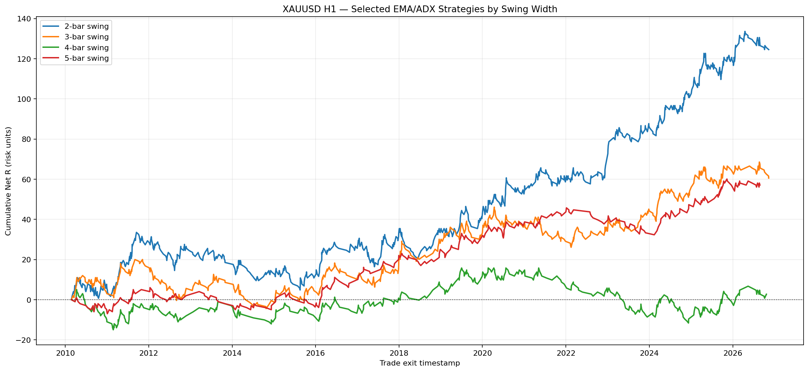

# 07 — Notebook 04: Swing-window sensitivity

**Source notebook:** [`04_Swing_Window_Experiment_H1.ipynb`](../notebooks/04_Swing_Window_Experiment_H1.ipynb)

## Purpose

Notebook 04 studies how the number of candles on each side of a candidate pivot changes the selected EMA/ADX-filtered strategy results. It compares swing widths of 2, 3, 4, and 5 bars per side.

The strategy selection is:

- Bullish N in Bullish regimes.
- Ranging N in Sideways regimes.
- Bearish N excluded.

## Earlier full-sample results

| Swing bars each side | Trades | Net R | Profit factor | Max drawdown (R) |
|---:|---:|---:|---:|---:|
| 2 | 872 | +124.52R | 1.229 | -28.68R |
| 3 | 614 | +60.54R | 1.155 | -24.43R |
| 4 | 450 | +2.71R | 1.009 | -27.41R |
| 5 | 344 | +57.06R | **1.270** | **-13.42R** |

## How to interpret this notebook relative to Notebook 05

Notebook 04 is an earlier sensitivity experiment. Notebook 05 rewrites the experiment to:

1. Explicitly require the stricter Bullish N geometry `P1 < P3 < P2`.
2. Apply regime eligibility **before** each strategy's position allocation.
3. Enforce one active Bullish N position and one active Ranging N position independently.
4. Permit the two strategies to overlap, with a maximum of two combined positions.
5. Add a concurrency audit and fixed-lot account simulation.

For these reasons, the 3-bar result in Notebook 04 (+60.54R from 614 trades) is not directly comparable to the refined 3-bar result in Notebook 05 (+88.78R from 758 trades). The difference is not explained by swing width alone; the implementation and eligibility/position-allocation sequence were also changed.

Notebook 05 is the current reference for swing-width plus position-capacity research.
