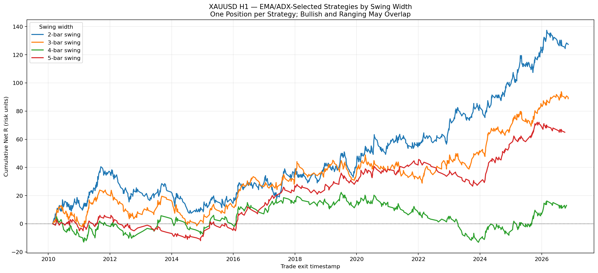
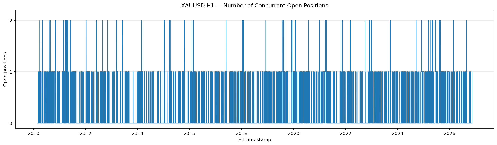
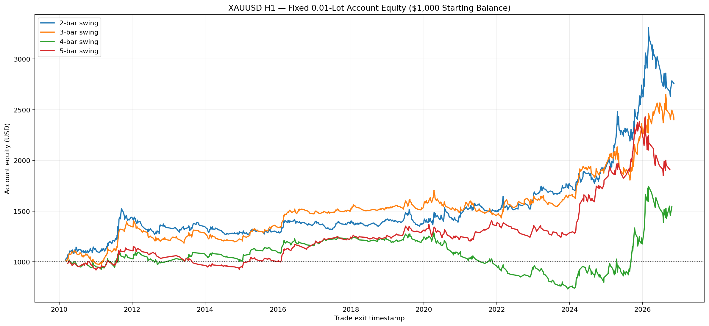

# 08 — Notebook 05: Position capacity and account simulation

**Source notebook:** [`05_Per_Strategy_Position_Capacity_H1.ipynb`](../notebooks/05_Per_Strategy_Position_Capacity_H1.ipynb)

## Purpose

Notebook 05 combines the swing-width experiment with explicit position-capacity controls and a simplified account simulation. It evaluates 2-, 3-, 4-, and 5-bar swing confirmation widths using the selected EMA/ADX strategies.

## Regime selection and position rules

- Bullish N is eligible only when the setup-confirmation candle is EMA/ADX Bullish.
- Ranging N is eligible only when the setup-confirmation candle is EMA/ADX Sideways.
- Bearish N is excluded.
- Maximum one active Bullish N position at a time.
- Maximum one active Ranging N position at a time.
- Bullish N and Ranging N may overlap.
- Maximum combined open positions: two.

Importantly, regime eligibility is applied **before** a candidate enters the strategy's position lock. An off-regime setup therefore cannot consume a strategy slot.

## Strict Bullish N geometry

The latest version explicitly requires:

`P1 < P3 < P2`

This is stricter than earlier implementations that required only P3 > P1. The revised rule changes which patterns qualify.

## Parameters held constant across the four widths

| Parameter | Setting |
|---|---:|
| EMA | 50 and 200 |
| ADX | 14; threshold 20 |
| ATR | 14 |
| Entry buffer | 0.05 ATR |
| Stop buffer | 0.05 ATR |
| Range tolerance | 0.50 ATR |
| Reward target | 2R |
| Pending order expiry | 20 H1 bars |
| Bullish N position cap | 1 |
| Ranging N position cap | 1 |
| Combined position cap | 2 |

The variable under test is the swing width, measured in bars on each side of the candidate pivot.

## Performance by swing width

| Swing bars each side | Trades | Win rate | Net R | Profit factor | Average R | Max drawdown (R) |
|---:|---:|---:|---:|---:|---:|---:|
| 2 | 1,088 | 37.41% | **+127.35R** | 1.185 | 0.117R | -33.02R |
| 3 | 758 | 37.34% | +88.78R | 1.185 | 0.117R | -25.43R |
| 4 | 544 | 34.19% | +13.08R | 1.036 | 0.024R | -35.45R |
| 5 | 426 | 38.50% | +64.98R | **1.247** | **0.153R** | **-19.00R** |

### Component contributions

| Swing | Bullish N trades | Bullish N Net R | Ranging N trades | Ranging N Net R |
|---:|---:|---:|---:|---:|
| 2 | 766 | +50.10R | 322 | +77.25R |
| 3 | 564 | +39.96R | 194 | +48.82R |
| 4 | 410 | +11.50R | 134 | +1.58R |
| 5 | 333 | +55.98R | 93 | +9.00R |

## Position-capacity audit

| Swing | Max Bullish N | Max Ranging N | Max combined | H1 bars with both strategies open | Overlapping trade pairs |
|---:|---:|---:|---:|---:|---:|
| 2 | 1 | 1 | 2 | 1,098 | 100 |
| 3 | 1 | 1 | 2 | 777 | 69 |
| 4 | 1 | 1 | 2 | 798 | 43 |
| 5 | 1 | 1 | 2 | 355 | 18 |

All four experiment configurations passed the automated capacity assertions.

## Fixed-lot account simulation

Notebook 05 adds an illustrative account simulation using:

- Starting balance: USD 1,000.
- Fixed lot per position: 0.01.
- Assumed contract size: 100 troy ounces per 1.00 lot; 0.01 lot therefore represents 1 ounce.
- Each strategy can hold one 0.01-lot position simultaneously, so exposure may reach 0.02 lot.

The simplified price-difference formula is:

`P/L = (exit price − entry price) × direction × lot size × contract size`

| Swing | Trades | Net P/L | Ending equity | Max consecutive losses | Max drawdown | Worst single-trade loss |
|---:|---:|---:|---:|---:|---:|---:|
| 2 | 1,088 | **+$1,757.94** | **$2,757.94** | 18 | -$681.10 | -$142.90 |
| 3 | 758 | +$1,401.98 | $2,401.98 | 13 | -$328.04 | -$104.30 |
| 4 | 544 | +$546.63 | $1,546.63 | 12 | -$557.96 | -$104.29 |
| 5 | 426 | +$908.74 | $1,908.74 | 10 | -$579.12 | -$143.27 |

### Account simulation limitations

- Verify the broker's actual contract size, tick value, account currency conversion, lot minimum, and margin rules.
- The formula is a price-difference approximation, not broker-exact execution.
- Spread, commission, swap, slippage, leverage, margin, stop-out, and financing costs are excluded.
- Maximum drawdown is measured on an exit-event equity curve, not tick-by-tick floating equity.
- Consecutive-loss ordering uses exit timestamp, then entry timestamp and strategy. Simultaneous exits are netted at the timestamp for the equity curve.
- Fixed lot is not fixed percentage risk; the dollar risk varies with the stop distance.

## Interpretation

The 2-bar swing produced the largest historical Net R and simplified fixed-lot P/L. The 5-bar swing produced the highest profit factor, lowest R drawdown, and shortest combined consecutive-loss streak, but its fixed-lot account drawdown remained substantial. The 3-bar swing had lower fixed-lot account drawdown than the other tested widths in this sample.

These trade-offs should be evaluated on unseen data and after realistic costs. No width can be declared optimal from this full-sample comparison alone.
